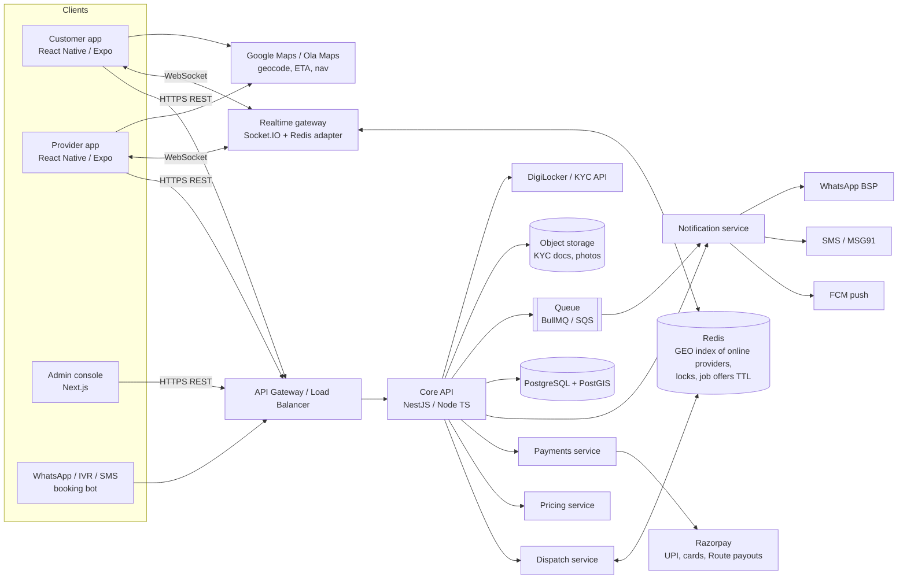
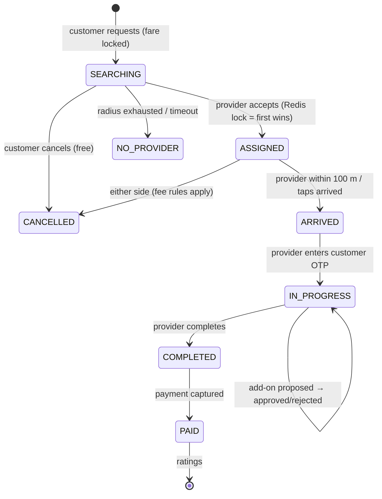

# OnSpot — System Architecture

Two layers in this doc:
1. **Production target** — what to build for real launch.
2. **Prototype (`prototype/`)** — a zero-dependency working simulation of the same flow, so you can demo/validate today.

---

## 1. Production architecture



### 1.1 Tech choices (and why)

| Layer | Choice | Why |
|---|---|---|
| Mobile apps | **React Native + Expo** (two apps, shared UI package) | One codebase for Android+iOS, OTA updates, background location via `expo-location`/task manager. India is ~95% Android → test low-end devices first. |
| Admin | **Next.js** | Fast to build, same TS stack. |
| Backend | **NestJS (Node + TypeScript)** modular monolith | Single deployable early; modules split cleanly into services later. Same language as apps. |
| Realtime | **Socket.IO** with Redis adapter | Rooms per job/provider, reconnection, fallbacks on bad networks. |
| DB | **PostgreSQL + PostGIS** | Transactions for money; geospatial queries for history/analytics/service areas. |
| Hot geo state | **Redis GEO** (`GEOADD`/`GEOSEARCH`) | Sub-ms nearest-provider lookups; online providers only. TTL keys auto-expire stale providers. |
| Queue | **BullMQ** (Redis) | Dispatch timeouts, offer waves, notifications, payouts. |
| Payments | **Razorpay** (UPI, cards, Route for split payouts) | India-first, UPI intent, marketplace split settlements. |
| Push/SMS | FCM + MSG91 (SMS fallback, OTP) | Highways have poor data → SMS fallback is essential. |
| Maps | Google Maps Platform or **Ola Maps** (cheaper in India) | Geocoding, distance matrix for ETA, navigation deep links. |
| Infra | AWS Mumbai (ap-south-1): ECS Fargate / or Railway/Render to start; RDS Postgres; ElastiCache Redis; S3 | Data residency in India, scales later. |
| Observability | Sentry, Grafana/Prometheus, structured logs | Emergency product — alerts on dispatch failures. |

### 1.2 Core domain model

```mermaid
erDiagram
  USER ||--o| PROVIDER_PROFILE : "may be"
  USER ||--o{ JOB : requests
  PROVIDER_PROFILE ||--o{ JOB : fulfils
  PROVIDER_PROFILE ||--o{ PROVIDER_SERVICE : offers
  SERVICE ||--o{ PROVIDER_SERVICE : ""
  SERVICE ||--o{ RATE_CARD : "priced by"
  CITY ||--o{ RATE_CARD : ""
  JOB ||--o{ JOB_EVENT : "timeline"
  JOB ||--o{ ADDON : "extra items"
  JOB ||--o| PAYMENT : ""
  JOB ||--o{ RATING : ""
  JOB ||--o{ DISPATCH_OFFER : ""
  PROVIDER_PROFILE ||--o{ KYC_DOC : ""
  PROVIDER_PROFILE ||--o{ PAYOUT : ""

  USER { uuid id; string phone; string name; string role; json emergency_contacts }
  PROVIDER_PROFILE { uuid id; string status_kyc; float rating; string vehicle_no; bool online; geography last_location }
  SERVICE { string code; string name; string category }
  RATE_CARD { int base; int per_km; int included_km; int tow_per_km; int night_pct; int night_cap }
  JOB { uuid id; string status; geography pickup; geography drop; json quote; string otp_hash; int final_amount }
  ADDON { uuid id; string label; int amount; string status }
  DISPATCH_OFFER { uuid id; uuid provider_id; string status; timestamp expires_at }
```

### 1.3 Job state machine



### 1.4 Dispatch algorithm (v1)

1. `GEOSEARCH online:{service} FROMLONLAT lng lat BYRADIUS 5 km ASC COUNT 10`.
2. Score = `0.6·(1/ETA) + 0.25·rating + 0.15·acceptance_rate` (penalise recent declines).
3. **Offer waves**: send to top 3 for 20 s. First accept acquires `SET job:{id}:lock provider NX`. Others get "taken".
4. No accept → next wave, expand radius 5 → 10 → 20 → 40 km (highways need wide radius).
5. After ~3 min → `NO_PROVIDER`: show fallback (helplines, nearest 24×7 shops), keep a "notify me" background search.

### 1.5 Pricing (Fair Price Lock)
```
fare = base
     + max(0, approach_km − included_km) × per_km
     + tow_km × tow_per_km              (towing only)
night = min(fare × night_pct, night_cap)   (22:00–06:00)
total = fare + night + platform_fee
final = total + Σ approved_addons          (never more)
provider_payout = (fare + night + approved_addons) × (1 − commission)
```
Quote is signed server-side and stored on the job (immutable). Add-ons need customer approval event.

### 1.6 Realtime events (WebSocket)

| Event | To | Payload |
|---|---|---|
| `job.offer` | provider | job summary, fare, distance, expires_at |
| `job.offer_revoked` | provider | job id |
| `job.updated` | customer + provider | full job snapshot |
| `provider.location` | customer (job room) | lat, lng, eta |
| `addon.proposed` | customer | addon |

### 1.7 Security
* JWT access (15 min) + refresh tokens; phone OTP login rate-limited.
* OTP for job start stored hashed; 5 attempts max.
* Location shared only when provider online / customer has active job. Delete raw GPS trails after 90 days (DPDP).
* KYC docs in private S3 with signed URLs; PII encrypted at rest.
* Webhooks (Razorpay) verified by signature; idempotency keys on payments.

### 1.8 Scaling path
Modular monolith → extract **dispatch + realtime** first (the hot path) → per-city Redis shards → event bus (Kafka) when analytics/ML pricing needed.

---

## 2. Prototype architecture (`prototype/`)

Goal: prove the full flow end-to-end with **zero installs** (just Node ≥18).

```
prototype/
├── server.js          # HTTP server: REST API + Server-Sent Events + static files
│                      # in-memory store persisted to data.json
│                      # dispatch engine, pricing, simulated "bot" providers
└── public/
    ├── index.html     # SPA shell (Leaflet map via CDN, OSM tiles)
    ├── styles.css     # design tokens, light/dark
    └── app.js         # Customer, Provider and Admin apps (hash routes)
```

| Production piece | Prototype stand-in |
|---|---|
| Socket.IO | Server-Sent Events (`/api/events`) |
| Redis GEO | In-memory haversine scan |
| Postgres | `data.json` |
| Real providers | Seeded **bot providers** that auto-accept, drive, start, propose add-ons, complete (plus you can be a real provider in a second tab) |
| Payments | Mock (UPI/Card/Cash) |
| Maps routing | Straight-line × 1.35 road factor, 32 km/h avg |

The REST contract and job state machine are **the same** as production, so the Expo apps can be built against the same API shape.
